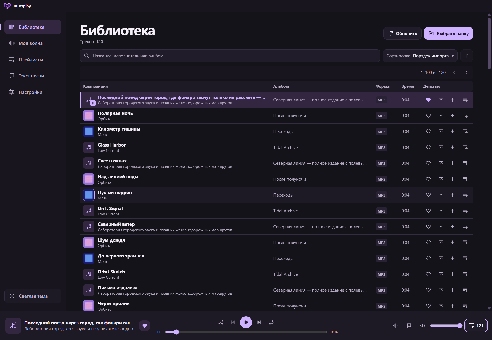

# mustplay

Десктопный плеер для локальной музыки на Windows. Он собирает локальные аудиофайлы в библиотеку и подбирает треки из неё в персональном радио «Моя волна». Текущая версия — **0.8.0**. [Что изменилось и как импортировать курсор](docs/RELEASE_NOTES_0.8.0.md).

*English summary · mustplay is a Windows desktop player for local audio files, with playlists, a playback queue and explainable recommendations.*

## Возможности 0.8.0

- Рекурсивный импорт и исключение папок, чтение тегов и встроенных JPEG/PNG-обложек, поиск и сортировка по библиотеке.
- Плейлисты и редактируемая очередь с перемешиванием и повтором.
- Локальное сохранение библиотеки, лайков, истории, громкости, очереди и позиции воспроизведения.
- Радио «Моя волна» с режимами **Знакомое**, **Баланс** и **Открытия**. Панель **Почему этот трек?** объясняет автоматический выбор.
- Инструменты исследования для сравнения алгоритмов, проведения слепого пилота и экспорта оценок. [Методика](docs/RECOMMENDATION_EXPERIMENT.md).
- Полноэкранный плеер, «Текстомузыка» и обычные тексты песен из локальных файлов и тегов.
- Мини-плеер с закреплением поверх окон, настраиваемые глобальные сочетания и таймер сна. [Руководство по функциям плеера](docs/PLAYER_EXPERIENCE.md).
- Светлая и тёмная темы. Кнопка внизу боковой панели переключает тему с плавным переходом. Выбор сохраняется для основного окна и мини-плеера.
- Масштаб интерфейса от 80% до 150%, анимация лайка, выбор системного, встроенного или импортированного курсора.
- Пресеты Speed Up и Slowed с изменением темпа и высоты тона. Reverb включается отдельно для каждого пресета. Меню доступно во всех режимах плеера.
- Выдвижной регулятор громкости на полноэкранной обложке и диско-режим с мягкими волнами на басовых ударах.

## Скриншоты



Скриншоты сделаны на синтетических треках. [Светлая тема и текст песни](docs/screenshots/0.7.0-light.png) · [Полноэкранный регулятор громкости](docs/screenshots/0.7.0-fullscreen-volume.png) · [Звуковые эффекты в мини-плеере](docs/screenshots/0.7.0-mini-effects.png) · [Диско-режим](docs/screenshots/0.7.0-disco.png) · [«Моя волна»](docs/screenshots/0.7.0-wave.png) · [Очередь](docs/screenshots/0.7.0-queue.png) · [Плейлисты](docs/screenshots/0.7.0-playlists.png).

## Сборка 0.8.0

Переносимый архив для Windows x64 можно собрать локально. [Инструкция по Windows-сборке](docs/WINDOWS_RELEASE.md).

## Разработка

На Windows x64 установите Node.js **24.22.x** и pnpm **11.25.0**. Выполните команды в корне клонированного репозитория.

```powershell
npm install --global pnpm@11.25.0
pnpm install --frozen-lockfile --store-dir .pnpm-store
pnpm exec install-electron
pnpm build
pnpm start
```

Если pnpm нужной версии уже установлен, начните со второй команды. Для разработки с обновлением интерфейса запустите `pnpm dev`. Папка `tests/fixtures` содержит синтетические MP3 и FLAC для первого импорта.

```powershell
pnpm typecheck
pnpm test
pnpm test:desktop
```

`pnpm build` также проверяет типы. `pnpm test:desktop` запускает собранное приложение в интерактивном Windows-сеансе. Для упаковки и проверки ZIP используйте `pnpm package:windows` и `pnpm test:release`. Подготовка архива и сценарии обновления описаны отдельно. [Windows-сборка](docs/WINDOWS_RELEASE.md).

## Технологии и архитектура

Electron, React, TypeScript, Tailwind CSS, SQLite через `node:sqlite`, music-metadata, electron-vite и Vitest.

- **Main** управляет диалогами, импортом, SQLite и доступом к аудио по ID источника.
- **Preload** предоставляет именованные операции через типизированный IPC. **Renderer** отображает интерфейс и управляет одним `HTMLAudioElement`.
- Контракты находятся в `src/shared`. Алгоритм в `src/recommendations` работает с обычными данными независимо от Electron, React и SQLite.

## Roadmap

- **0.5.0 · Explainable Recommendations & Research** — объяснения «Моей волны» и инструменты сравнения.
- **0.6.0 · Player Experience** — тексты песен, мини-плеер, глобальные клавиши и таймер сна.
- **0.7.0** — mustplay, светлая тема, масштаб интерфейса, звуковые пресеты с Reverb и диско-режим.
- **Далее** — развитие локального воспроизведения и метаданных. Эксперименты с внешними музыкальными сервисами и yt-dlp отложены на неопределённый срок.

## Ограничения

- Поддерживаются локальные MP3, AAC, M4A/MP4 с AAC, FLAC, WAV PCM, Ogg Vorbis, Opus и WebM с Opus/Vorbis. ALAC, AIFF и WMA не поддерживаются.
- Проверки релиза выполнены для Windows x64. Сборки для macOS и Linux отсутствуют в этом выпуске.
- SQLite хранится в профиле Windows, а библиотека ссылается на файлы на диске. После изменений повторите импорт. [Хранение и миграции](docs/PERSISTENT_LIBRARY.md).
- Объяснения доступны для автоматических рекомендаций текущего сеанса. Результаты технического сравнения получены на синтетическом каталоге. [Результаты исследования](docs/EXPERIMENT_RESULTS.md).

## Лицензия

Код mustplay распространяется по [лицензии MIT](LICENSE). Сторонние компоненты, включая npm-зависимости, Electron, Chromium и FFmpeg, распространяются на условиях их собственных лицензий. [Уведомления и состав Windows-сборки](docs/WINDOWS_RELEASE.md#сторонние-компоненты-zip).

## Документация

- [История версий](CHANGELOG.md) · [Участие в разработке](CONTRIBUTING.md) · [Сообщение об уязвимости](SECURITY.md)
- [Библиотека](docs/LIBRARY_EXPERIENCE.md) · [Плейлисты](docs/PLAYLISTS.md) · [Очередь и горячие клавиши](docs/PLAYBACK_QUEUE.md)
- [Рекомендации и объяснения](docs/RECOMMENDATION_EXPLAINABILITY.md) · [Технический аудит](docs/TECHNICAL_AUDIT.md)
