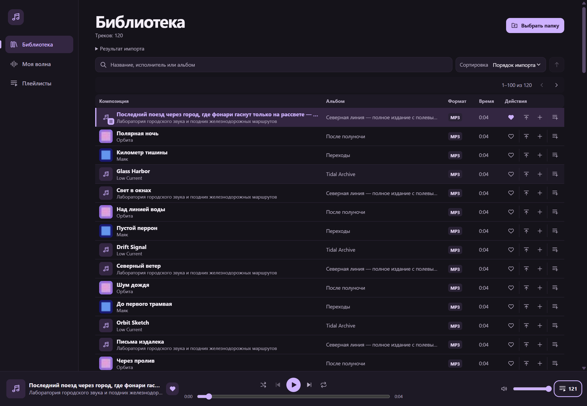

# Music Player

Десктопный плеер для локальной музыки на Windows. Он собирает MP3 и FLAC в библиотеку и подбирает треки из неё в персональном радио «Моя волна». Проект в активной разработке. Версия первого публичного выпуска — **0.5.0**.

*English summary · Music Player is a Windows desktop player for local MP3 and FLAC files, with playlists, a playback queue and explainable recommendations.*

## Возможности 0.5.0

- Рекурсивный импорт папок, чтение тегов и встроенных JPEG/PNG-обложек, поиск и сортировка по библиотеке.
- Плейлисты и редактируемая очередь с перемешиванием и повтором.
- Локальное сохранение библиотеки, лайков, истории, громкости, очереди и позиции воспроизведения.
- Радио «Моя волна» с режимами **Знакомое**, **Баланс** и **Открытия**. Панель **Почему этот трек?** объясняет автоматический выбор.
- Инструменты исследования для сравнения алгоритмов, проведения слепого пилота и экспорта оценок. [Методика](docs/RECOMMENDATION_EXPERIMENT.md).

## Скриншоты



Синтетическая библиотека. [«Моя волна» и объяснение рекомендации, 0.5.0](docs/screenshots/0.5.0-wave-explanation.png) · [Очередь, 0.5.0](docs/screenshots/0.5.0-queue.png) · [Плейлисты, 0.4.1](docs/screenshots/0.4.1-playlists.png).

## Выпуск 0.5.0

Выпуск [Music Player v0.5.0](https://github.com/strr988/MusicPlayer/releases/tag/v0.5.0) предназначен для распространения исходного кода. Готовый Windows ZIP пока недоступен. На Windows 11 x64 приложение можно собрать и запустить по инструкции ниже.

## Разработка

На Windows x64 установите Node.js **24.22.x** и pnpm **11.25.0**. Выполните команды в корне клонированного репозитория.

```powershell
npm install --global pnpm@11.25.0
pnpm install --frozen-lockfile --store-dir .pnpm-store
pnpm exec install-electron
pnpm build
pnpm start
```

Если pnpm нужной версии уже установлен, начните со второй команды. Для разработки с обновлением интерфейса запустите `pnpm dev`. Папка `tests/fixtures` содержит синтетические MP3 и FLAC для первого импорта.

```powershell
pnpm typecheck
pnpm test
pnpm test:desktop
```

`pnpm build` также проверяет типы. `pnpm test:desktop` запускает собранное приложение в интерактивном Windows-сеансе. Для упаковки и проверки ZIP используйте `pnpm package:windows` и `pnpm test:release`. Подготовка архива и сценарии обновления описаны отдельно. [Windows-сборка](docs/WINDOWS_RELEASE.md).

## Технологии и архитектура

Electron, React, TypeScript, Tailwind CSS, SQLite через `node:sqlite`, music-metadata, electron-vite и Vitest.

- **Main** управляет диалогами, импортом, SQLite и доступом к аудио по ID источника.
- **Preload** предоставляет именованные операции через типизированный IPC. **Renderer** отображает интерфейс и управляет одним `HTMLAudioElement`.
- Контракты находятся в `src/shared`. Алгоритм в `src/recommendations` работает с обычными данными независимо от Electron, React и SQLite.

## Roadmap

- **0.5.0 · Explainable Recommendations & Research** — объяснения «Моей волны» и инструменты сравнения.
- **0.6.0 · Music Sources & yt-dlp Integration** — запланированы архитектура музыкальных источников и интеграция yt-dlp.
- **Далее** — расширение метаданных, форматов и музыкальных сервисов.
- **Долгосрочно** — единая библиотека для разных источников музыки.

## Ограничения

- Версия 0.5.0 работает с локальными MP3 и FLAC. Загрузка музыки из интернета и интеграции Spotify, YouTube Music, SoundCloud, Apple Music и других сервисов пока отсутствуют.
- Проверки релиза выполнены для Windows x64. Сборки для macOS и Linux отсутствуют в этом выпуске.
- SQLite хранится в профиле Windows, а библиотека ссылается на файлы на диске. После изменений повторите импорт. [Хранение и миграции](docs/PERSISTENT_LIBRARY.md).
- Объяснения доступны для автоматических рекомендаций текущего сеанса. Результаты технического сравнения получены на синтетическом каталоге. [Результаты исследования](docs/EXPERIMENT_RESULTS.md).

## Лицензия

Код Music Player распространяется по [лицензии MIT](LICENSE). Сторонние компоненты, включая npm-зависимости, Electron, Chromium и FFmpeg, распространяются на условиях их собственных лицензий. [Уведомления и состав Windows-сборки](docs/WINDOWS_RELEASE.md#сторонние-компоненты-zip).

## Документация

- [История версий](CHANGELOG.md) · [Участие в разработке](CONTRIBUTING.md) · [Сообщение об уязвимости](SECURITY.md)
- [Библиотека](docs/LIBRARY_EXPERIENCE.md) · [Плейлисты](docs/PLAYLISTS.md) · [Очередь и горячие клавиши](docs/PLAYBACK_QUEUE.md)
- [Рекомендации и объяснения](docs/RECOMMENDATION_EXPLAINABILITY.md) · [Технический аудит](docs/TECHNICAL_AUDIT.md)
